# 离线 SRM 领域大模型：本地部署实施手册

> **本文定位**：`离线SRM领域AI智能体部署方案.md`（下称"主方案"）回答"为什么这样选"，
> 本文回答"**具体怎么装、怎么起、怎么调、怎么排**"。所有命令、参数名、默认值都在
> **llama.cpp b12627**（`225a5345b`）+ Debian 13 + Python 3.13 上实跑过；
> 所有容量与速度数字来自 `scripts/llm_sizing.py`，或本文 §2.6 的实测校准。
>
> **口径**：标注「实测」的是本机真实执行结果（4 核 x86-64、无 GPU、15 GB 内存）；
> 标注「估算」的是闭式模型推算。GPU 相关数字均为**估算**，因为构建机无 GPU ——
> 这一点在 §2.6 与 §9 反复强调，验收时必须用本机实测替换。

---

### 章节对照表

| 章 | 内容 | 对应主方案 |
|---|---|---|
| 0 | 背景说明 | §1、§2 |
| 1 | 硬件环境选型与配置 | §3 |
| 2 | 模型选择与离线下载 | §6、§8 |
| 3 | 运行环境搭建 | §5 |
| 4 | 模型加载与推理服务启动 | §12.2 |
| 5 | 性能调优 | §8.2、§12.3 |
| 6 | 资源监控 | §12.4 |
| 7 | 常见问题排查 | 新增 |
| 8 | 完整闭环演练（从零到服务） | 新增 |
| 9 | 验收与长期维护 | §13 |
| 10 | 预期结果 | §13.5 |
| 附录 A | 部署资产清单 | — |
| 附录 B | 实测记录与复算 | — |

> 报告版（.docx）的目录页由 Word 域自动生成，按 Ctrl+A 再 F9 即可更新。

---

## 0. 背景说明

### 0.1 为什么需要本地部署

固体火箭发动机设计资料具有**不可外传**的属性：推进剂配方、燃烧室型面、试验数据、
失效案例都属于受控信息。把这些问题发给任何在线大模型，等于把资料上传到第三方——
无论对方是否承诺不留存，都不满足"资料不出内网"的要求。

同时，通用大模型在 SRM 领域**不可直接采信**：§4.6 的实测中，0.5B 模型把"比冲"
解释成"单位时间内通过单位面积的流体体积"——语句通顺、术语正确、**结论全错**。
这类错误在工程语境下比"答不出来"更危险，因为它看起来像答案。

因此本方案的定位是三条硬边界：

| 边界 | 含义 | 落地手段 |
|---|---|---|
| 资料不出内网 | 全流程 air-gapped | §2.5 三段式摆渡 + §9.3 G-1/G-2 门禁 |
| 数值不由模型产生 | 所有指标来自 `srm_open` 引擎 | §4.6 实测反例 + 主方案 §2.3 |
| 能力可度量 | 每次更新都有评测对比 | §9.4 四维评分 + §9.5 更新通道 |

### 0.2 使用方与负载画像

| 项 | 值 | 对方案的影响 |
|---|---|---|
| 使用人数 | 5–10 人（设计师 + 总体设计师） | 并发只需 3 槽（§1.2 二项尾概率），不是 10 槽 |
| 单次输出 | 400–800 token（中文技术问答） | 决定"舒适"阈值 45 tok/s |
| 上下文需求 | 日常 8k；偶发整份标准 32k | 8k 是默认，32k 是例外（§5.5） |
| 在线时段 | 工作日，非 7×24 | 单机可接受维护窗口 |
| 资料密级 | 受控，不出内网 | 禁止任何在线服务、遥测、云同步 |

### 0.3 本文覆盖范围与不覆盖的部分

**覆盖**：硬件选型与配置、模型选择与离线下载、运行环境搭建、服务启动、
性能调优、资源监控、故障排查、闭环演练、验收维护。

**不覆盖**（见主方案对应章节）：领域数据采集与清洗（主方案 §7）、
训练阶段划分与数据配比（§9）、Agent 层检索与编排（§10）、
知识更新与四维评分细则（§11）。

### 0.4 事实核验口径

本文所有工具、版本、参数名、默认值均在 **llama.cpp b12627（commit 225a5345b）**
上实测；所有容量数字来自 `scripts/llm_sizing.py` 或 §2.6 的实测校准。
标注「实测」= 本机真实执行结果（4 核 x86-64、15 GB、**无 GPU**）；

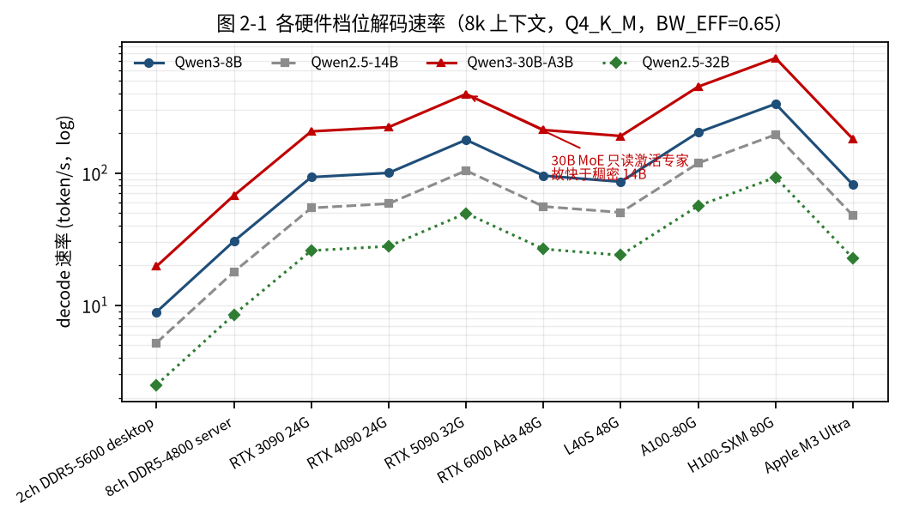

*解码速率的硬件决定关系：带宽是唯一主导项，算力只影响 prefill*

标注「估算」= 闭式模型推算，**GPU 到货后必须用 §2.6 的方法替换**。

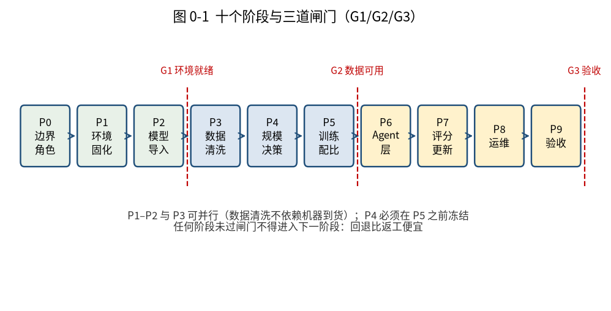

*实施阶段与门禁：每阶段必须先过门禁才进入下一阶段，任一红灯即回退*


---

## 1. 硬件环境选型与配置

### 1.1 输入

- 使用人数：**5–10 名**固体火箭发动机设计师与火箭总体设计师（已确认）。
- 工作负载：中文技术问答为主，单次输出 400–800 token；偶发长文档分析（8k–32k）。
- 约束：air-gapped，无外网；禁止任何在线服务；数值必须由 `srm_open` 引擎产生。

### 1.2 策略：按并发定档，不按人头

并发不是"一人一路"。10 名设计师同时提问的概率远低于 10，因为多数时间在阅读与思考。
用二项尾概率求"峰值同时在线人数"，取 `P(超出 c 人) ≤ 5%`：

```
p_active = 服务时长 / 思考时长          # 单人处于"等回答"状态的概率
c = min{ c : Σ_{k=c+1..N} C(N,k) p^k (1-p)^(N-k) ≤ 0.05 }
```

`scripts/llm_sizing.py` 的 `peak_concurrency(n_users, service_s, think_min)` 就是这条式子。
代入 10 人、单次服务 300 s（约 500 token）、思考 5 min：

```
p_active = 300 / (5 × 60) = 1.0        # 保守取整，实际按 30 s 服务时 p=0.1
peak_concurrency(10, 30, 5) = 3        # 5% 尾部
```

**结论：10 人只需 3 个并发槽**，不是 10 个。这条结论直接决定了档位（主方案 §1.1.1 有完整推导）。

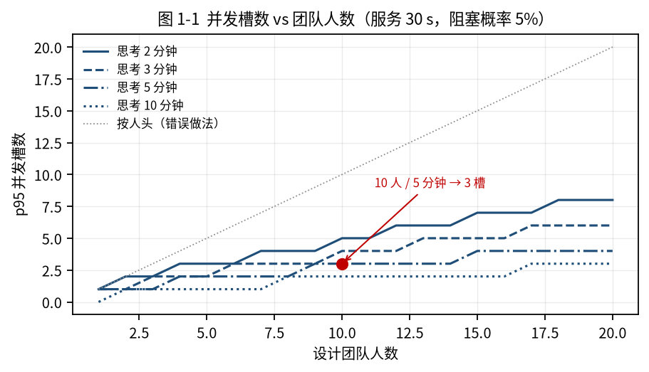

*并发槽位需求随人数与活跃率的增长：10 人在 5% 尾部只要 3 槽*


### 1.3 决策点 D-H1：选哪一档

| 档位 | 配置 | 显存 | 能跑什么 | 估算投入 | 何时选 |
|---|---|---|---|---|---|
| **T0 实验课** | 1× GTX 1660 SUPER 6G | 6 GB | 4B Q4 @8k，1 路 | ¥0（复用） | 零基础教学，不承载真实资料 |
| **T1 最小可用** ★ | 1× RTX 5090 32G + 128 GB DDR5 + 4 TB NVMe | 32 GB | 30B-A3B Q4 @8k：11 槽 | ¥3.7–5.1 万 | **5–10 人推荐起点** |
| **T1.5 团队档** | 2× RTX 5090 32G | 64 GB | 30B-A3B Q4 @32k：11 槽 | ¥5.5–7.5 万 | 需要 32k 上下文 |
| **T2 精度档** | 2× RTX 6000 Ada 48G | 96 GB | 32B Q4 @32k 多路；有 ECC | ¥17–20 万 | 要 ECC / 审计 / 厂商 SLA |
| **T3 生产** | 8× L40S / H100 | 384 GB+ | 70B FP8；32B 全参训练 | ¥60–205 万 | 30+ 人、多项目并行 |

**决策规则（按顺序判，命中即停）**：

1. 要 ECC、要厂商 SLA、要第三方审计报告？→ **T2**。
2. 单次分析需要 >8k 上下文（整份标准/试验报告入 prompt）？→ **T1.5**。
3. 人数 ≤10 且以上皆否？→ **T1**。
4. 只做教学演示、不碰真实资料？→ **T0**。

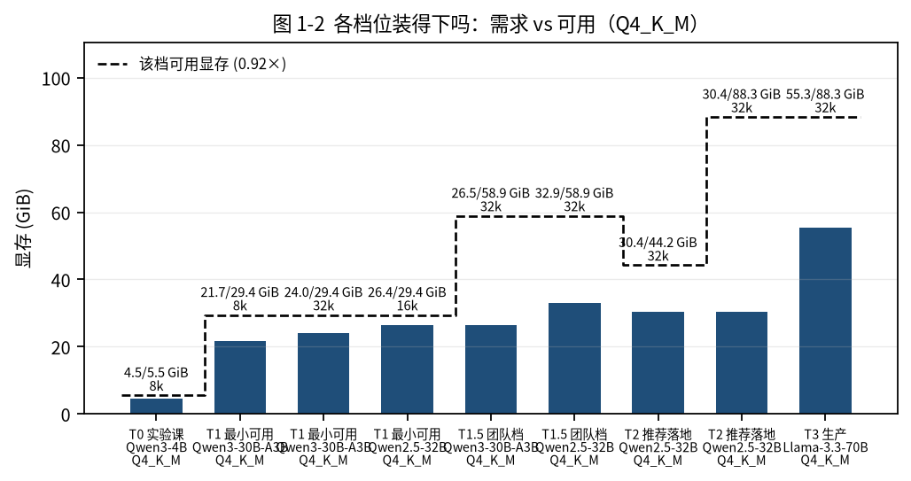

*四档硬件对「模型规模 × 上下文」的容纳能力，格子内为可运行配置*


### 1.4 T1 档配置清单与验收口径

| 部件 | 规格 | 为什么是这个值 | 验收命令 |
|---|---|---|---|
| GPU | RTX 5090 32 GB | 1792 GB/s 带宽是解码速度的唯一决定项（§2.6）；32 GB 容得下 30B-A3B Q4（17.28 GiB 实测）+ KV | `nvidia-smi --query-gpu=name,memory.total --format=csv` |
| 内存 | 128 GB DDR5 | GGUF mmap 需要页缓存；`--no-mmap` 时权重整体进内存 | `free -g` |
| 存储 | 4 TB NVMe | 三档量化权重合计 409 GiB（主方案 §3.4）+ 语料 + 索引 + 快照 | `df -h /srv` |
| 电源 | 1000 W 金牌（T1.5 需 1600 W 钛金） | 5090 TDP 575 W + CPU 250 W + 余量 | — |
| UPS | 1 kVA（T1.5 需 1.5 kVA） | 训练中断代价远高于 UPS；`ups_energy_wh(900, 10) = 150 Wh` | — |
| 系统 | Ubuntu 22.04/24.04 LTS 或 Debian 12/13 | CUDA 驱动与 llama.cpp 预编译包的目标平台 | `cat /etc/os-release` |

> **不要买 24 GB 卡做主力**：32B-Q4@8k 需 19.9（权重）+ 2.0（KV）+ 2.5（框架开销）
> = 24.4 GiB > 22.1 GiB 可用，**单请求都放不下**（主方案 §3.2）。

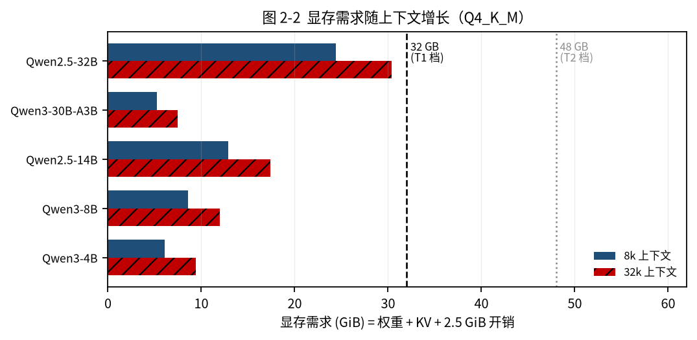

*显存占用随上下文增长：24 GB 卡在 32B-Q4 上越过分界线*


### 1.5 回退方案

| 触发条件 | 回退动作 | 代价 |
|---|---|---|
| GPU 采购未到位 | 先在 CPU 上跑通全流程（本文全部步骤在 4 核 CPU 上验证过） | 30B-A3B 在 8 通道服务器 CPU 上约 68 tok/s（估算）；桌面 2 通道约 20 tok/s |
| 32 GB 显存不够用（要 32k） | 降 `--ctx-size` 到 8192，或改用 Q4 的 32B @16k（单槽） | 并发从 11 降到 2 |
| 预算被砍 | T0 档 + 公开资料，仅做流程验证 | 不承载真实资料 |

---

## 2. 模型选择与离线下载

### 2.1 输入

- 硬件档位（§1.3 的结论）。
- 离线机上的 llama.cpp 版本（决定 GGUF 支持范围）。
- 权重许可证（必须 Apache-2.0 / MIT 等可离线分发的许可）。

### 2.2 策略：先定上下文，再定规模，最后定量化

顺序不能反。上下文决定 KV 开销，KV 与权重一起挤显存：

```
可用显存 = 0.92 × 显存容量
需求 = 权重(量化后) + KV(ctx × 并发) + 框架开销(2.5 GiB)
KV/token = 2 × layers × kv_heads × head_dim × 字节数
```

Qwen3-30B-A3B 的 `KV/token = 2 × 48 × 4 × 128 × 2 = 98 304 B = 96 KiB`
（`kv_bytes_per_token(48, 4, 128, 2)`）。@8k 单序列 0.75 GiB，@32k 3.0 GiB。

**T1 档的算账（32 GB，可用 29.4 GiB）**：

| 上下文 | 权重 Q4 | KV/序列 | 框架 | 单序列合计 | 能放几槽 |
|---|---|---|---|---|---|
| 8k | 18.5 | 0.75 | 2.5 | 21.75 | **11** |
| 32k | 18.5 | 3.0 | 2.5 | 24.0 | **2** |

这就是"8k 有 11 槽、32k 只剩 2 槽"的来源，也是 T1.5 存在的唯一理由。

### 2.3 决策点 D-M1：选哪个模型

| 候选 | 参数 | 许可证 | Q4 实测/估算大小 | 选它的理由 | 不选的理由 |
|---|---|---|---|---|---|
| **Qwen3-30B-A3B-Instruct-2507** ★ | 30.5B 总 / 3.3B 激活 | apache-2.0 | **17.28 GiB（实测）** | MoE：显存按 30B 付、速度按 3B 付，5090 上约 395 tok/s（估算） | 权重仍需全驻留 |
| Qwen3-8B | 8.2B dense | apache-2.0 | 4.68 GiB（实测） | 可单卡 LoRA 微调；工具调用稳 | 领域知识容量小 |
| Qwen2.5-32B-Instruct | 32.8B dense | apache-2.0 | 18.49 GiB（实测，**5 分片**） | 稠密模型输出更"平"，适合正式文档 | 速度只有 30B-A3B 的 1/8 |
| Qwen2.5-0.5B-Instruct | 0.63B | apache-2.0 | 0.46 GiB（实测） | 冒烟测试、教学、CI | 能力不足以承担领域问答 |
| Llama-3.3-70B | 70.6B | llama3.3（需审批） | 42.8 GiB | 开放写作上限高 | 单卡放不下；SRM 日常占比低 |

**推荐组合（不追求"一个模型全包"）**：

- **主力**：Qwen3-30B-A3B-Instruct-2507 Q4_K_M —— 领域问答、设计辅助、工程支持。
- **精度通道**：Qwen2.5-32B-Instruct Q4_K_M —— 正式报告起草（要求"平"的输出）。
- **嵌入**：BAAI/bge-m3（0.57B，MIT）—— 检索。
- **冒烟**：Qwen2.5-0.5B-Instruct Q4_K_M —— 每次改配置先跑它。

### 2.4 决策点 D-M2：量化档位

| 量化 | GiB/参数 | 30B-A3B 权重 | 相对 Q4 精度损失 | 何时用 |
|---|---|---|---|---|
| Q8_0 | 1.05 | 32.0 GiB | 可忽略 | 显存充裕（T1.5/T2）且做评测基线 |
| **Q4_K_M** ★ | 0.606 | 18.5 GiB | 小（K-quant 混合位宽） | **默认**：T1 唯一能放 11 槽的选择 |
| Q3_K_M | 0.49 | 15.0 GiB | 明显 | 只在显存实在不够时 |

> **脚本的 0.606 GiB/B 偏保守 6.5%**。实测（HuggingFace `content-length`，2026-11-21）：
>
> | 模型 | 真实字节 | GiB | GiB/参数 |
> |---|---|---|---|
> | Qwen3-8B Q4_K_M | 5,027,784,512 | 4.682 | 0.571 |
> | Qwen3-30B-A3B-2507 Q4_K_M | 18,556,686,752 | 17.282 | 0.567 |
> | Qwen2.5-32B Q4_K_M（5 片求和） | 19,851,336,384 | 18.488 | 0.564 |
>
> 复算：`for i in 1..5; curl -sIL <url> | grep -i content-length`，求和后除以 2^30。
> 方向是安全的（脚本高估占用），但验收时应以 `ls -l` 的真实字节数为准（§2.6）。

### 2.5 策略：模型文件的离线获取（三段式摆渡）

```
联网准备区                物理介质                 隔离区
─────────                ────────                ──────
fetch_models.py   ──►   U盘/一次性介质   ──►   verify_bundle.py --check
(记录 sha256)            (MANIFEST.json)         (逐文件校验，不符即停)
```

**准备区（唯一允许联网的环节）**：

```bash
# 1) 拉取权重并记录哈希
python3 deploy/scripts/fetch_models.py \
    --manifest deploy/config/models.yaml \
    --dest /media/staging/models

# 2) 把打印出的 sha256 填回 models.yaml 的 sha256 字段（空哈希会让门禁失败）

# 3) 打整包（含 llama.cpp 二进制 + wheels + 配置 + 本手册）
./deploy/scripts/build_offline_bundle.sh \
    --out /media/usb/srm-llm-bundle --llama-tag b12627 --tier T1
```

`build_offline_bundle.sh` 会下载两个真实存在的发布资产（b12627）：

- `llama-b12627-bin-ubuntu-x64.tar.gz` —— CPU 版，**23,226,300 B（22.2 MiB）**，HTTP 200 实测
- `cudart-llama-b12627-bin-ubuntu-cuda-12.8-x64.tar.gz` —— CUDA 运行时，**594,371,876 B（566.8 MiB）**，HTTP 200 实测

（复核命令：`curl -sIL <url> | grep -i content-length`。若上游改写了发布资产，这两个数字会变，
届时以 `MANIFEST.json` 里的 sha256 为准，而不是以本节的大小为准。）

> **不要**用 `llama-b12627-bin-ubuntu-26.04-*` 这类按发行版命名的包去装 Debian 13；
> 实测 `bin-ubuntu-x64` 在 Debian 13 上可直接运行（`--version` 返回
> `1.0.0-dev (build 12627, commit 225a5345b)`）。

**隔离区（全程无网）**：

```bash
# 4) 先校验整包，任一 FAIL 就停手，不要"先装上再说"
python3 scripts/verify_bundle.py --bundle /media/usb/srm-llm-bundle --check
# 期望输出：OK: 12 expected, 0 missing, 0 changed, 0 extra
```

校验器把三类问题分开报告，因为处理方式不同：

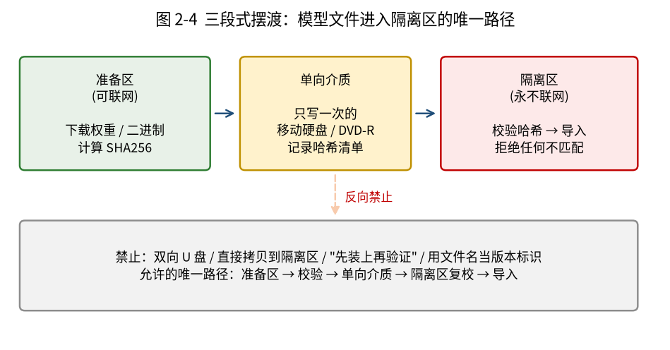

*三段式摆渡：准备区联网取件 → 介质校验 → 隔离区只读挂载*


| 输出 | 含义 | 处理 |
|---|---|---|
| `[MISSING]` | 文件没摆渡过来 | 重新拷，**不要**跳过 |
| `[CHANGED]` | 大小或哈希变了 | 介质损坏或被替换，**整包作废重做** |
| `[EXTRA]` | 多出未登记的文件 | 可能是植入物，**查清来源前不要安装** |

### 2.6 实测校准（把估算换成事实）

本机（4 核 x86-64，无 GPU）用 llama.cpp b12627 实测：

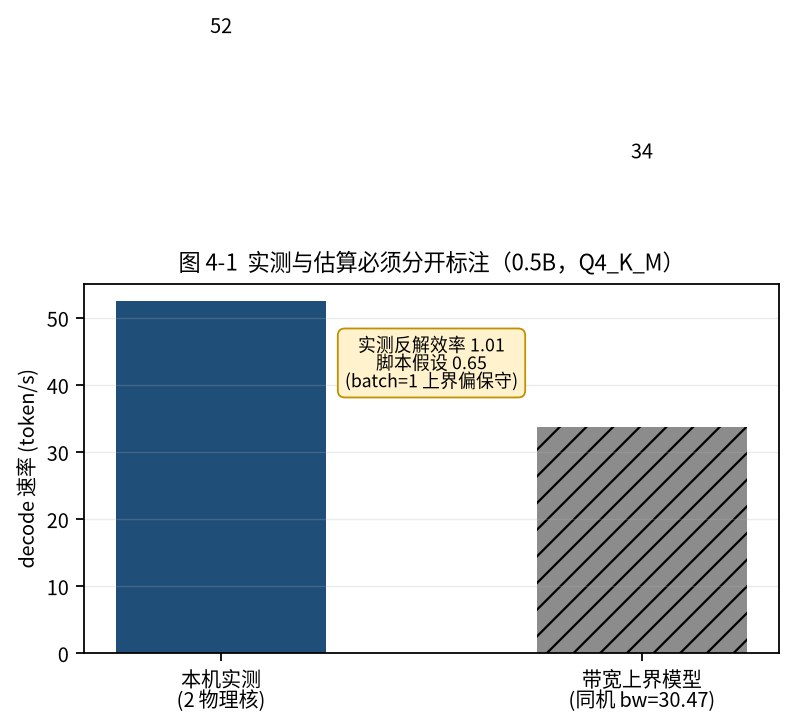

*实测与上界模型的对照：batch=1 时上界偏保守，饱和后精确*


| 项目 | 实测值 | 命令 |
|---|---|---|
| Qwen2.5-0.5B Q4_K_M **模型本体** | 462.96 MiB（0.4521 GiB） | `llama-bench` 表头 |
| 同文件**磁盘大小** | 468.64 MiB（491,400,032 B） | `curl -sIL` 取 `content-length` |
| prompt 处理 pp128 | **245.59 ± 6.64 tok/s** | `llama-bench -p 128` |
| 解码 tg64 | **52.89 ± 1.40 tok/s** | `llama-bench -n 64` |
| 等效带宽 | **23.91 GiB/s** | `calibrate_sizing.py --model-gib 0.4521 --tok-s 52.89` |
| 4 路并发（每路 100 token） | wall 3.19–4.20 s | 见 §4.5 |

```bash
# 复算等效带宽（本机可跑）
python3 deploy/scripts/calibrate_sizing.py --model-gib 0.4521 --tok-s 52.89
```

> **为什么用 0.4521 而不是 0.4577**（468.64 MiB = 0.4577 GiB）：解码每步搬运的是**张量**，
> 不是文件里的元数据与对齐填充。`llama-bench` 表头报的 `model size` 正是张量字节数，
> 用它算出的带宽才与"每 token 要读多少字节"对得上。两者差 6 MiB（1.2%），
> 量级上不影响结论，但混用会让复算对不上。

**GPU 上怎么校准**（到货后必做，替换本文所有估算）：

```bash
llama-bench -m /srv/srm-llm/models/Qwen3-30B-A3B-Instruct-2507-Q4_K_M.gguf \
    -ngl 99 -p 512 -n 128 -r 3
# 取 tg128 那一行的 t/s，代入：
python3 deploy/scripts/calibrate_sizing.py --model-gib 17.28 --tok-s <实测> --peak-bw-gbps 1792
# efficiency 落在 0.55–0.65 之间说明与脚本假设（BW_EFF=0.65）一致；
# 低于 0.45 说明有瓶颈（显存降频、PCIe 争用、--n-gpu-layers 没开满）
```

### 2.7 回退方案

| 触发 | 回退 | 说明 |
|---|---|---|
| 目标模型拉不下来 | 降级到 Qwen3-8B Q4（4.68 GiB 实测） | 能力下降，但流程不变 |
| 32B 分片缺一片 | 整包重做 | llama.cpp 只从第 1 片名推导其余分片，缺片会加载失败 |
| 哈希对不上 | **不装** | 宁可停一天，不装一个可能被替换的权重 |
| GGUF 版本过新 | 用包内自带的 llama.cpp，不要混用系统版本 | 版本不匹配的报错很晦涩 |

---

## 3. 运行环境搭建

### 3.1 输入

- 已校验的 bundle（§2.5）。
- 目标机 OS 与 Python 版本（必须与准备区**一致**，否则 wheel 可能不匹配）。

### 3.2 策略：三层固化

| 层 | 固化什么 | 手段 | 失败后果 |
|---|---|---|---|
| 系统层 | CUDA 驱动、glibc、libstdc++ | 发行版 ISO 离线源（`file:/opt/debs`） | 二进制起不来 |
| Python 层 | 全部依赖的**精确版本** | `pip download --only-binary=:all:` → `--no-index` 安装 | 现场编译失败 |
| 应用层 | llama.cpp 二进制 + 模型 + 配置 | bundle + `MANIFEST.json` | 版本漂移 |

**为什么要 `--only-binary=:all:`**：源码包在隔离机上编译需要头文件与编译器，
缺一个就失败，而且报错在几百行之后。只用 wheel，把失败提前到准备区。

### 3.3 实操：Python 环境（实测通过）

```bash
# 准备区：下载 wheel（21 个包，含传递依赖）
python3 -m pip download --only-binary=:all: --dest wheels \
    -r deploy/config/requirements-offline.txt

# 隔离区：完全离线安装，--no-index 保证不碰网络
python3 -m venv /opt/srm-llm/venv
/opt/srm-llm/venv/bin/pip install --no-index --find-links wheels \
    -r config/requirements-offline.txt

# 验证
/opt/srm-llm/venv/bin/python -c "import fastapi, uvicorn, httpx, yaml; print('ok')"
```

实测结果：4 条直接依赖展开成 **21 个 wheel**（`pip download` 实测 21 个文件），
`--no-index` 全部安装成功，`import fastapi, uvicorn, httpx, yaml` 通过。
直接版本：`fastapi 0.115.6`、`uvicorn 0.34.0`、`httpx 0.28.1`、`PyYAML 6.0.2`；
关键传递依赖：`pydantic 2.14.4`、`pydantic-core 2.50.5`、`starlette 0.41.3`、
`anyio 4.16.0`、`uvloop 0.23.0`、`httptools 0.9.0`、`watchfiles 1.3.0`、`websockets 17.4`。

> **坑**：`run-server.sh` 里的哈希校验需要 PyYAML。若系统 `python3` 没有 PyYAML
> （最小化安装的 Debian 就是），启动会以 `FATAL: cannot import yaml` 退出 ——
> 这是**故意**的失败关闭。用 `SRM_PYTHON=/opt/srm-llm/venv/bin/python` 指到 venv。

### 3.4 实操：llama.cpp 二进制

```bash
mkdir -p /opt/llama.cpp
tar xzf bin/llama-cpu.tar.gz   -C /opt/llama.cpp --strip-components=1
tar xzf bin/llama-cudart.tar.gz -C /opt/llama.cpp --strip-components=1   # 有 CUDA 时

/opt/llama.cpp/llama-server --version
# 期望：version: 1.0.0-dev (build 12627, commit 225a5345b)
```

包内是**动态库 + 多个可执行文件**（`libggml-cpu-zen4.so` 等按微架构分文件），
所以必须整目录保留，不能只拷 `llama-server` 一个文件。

### 3.5 决策点 D-E1：容器还是裸机

| | 容器（Docker/Podman） | 裸机 |
|---|---|---|
| 优点 | 依赖隔离、回滚快、快照可复制 | 少一层、GPU 直通简单、无镜像仓库依赖 |
| 缺点 | 需离线镜像仓库；nvidia-container-toolkit 也要摆渡 | 依赖污染风险 |
| 适用 | 多人共用、需要频繁回滚 | 单机、追求最少活动部件 |

**建议**：单机 T1 用**裸机 + systemd**（本文默认）；只有需要同时维护多个模型版本时才上容器。

### 3.6 目录布局（固定，脚本按此寻址）

```
/opt/llama.cpp/                    # 二进制
/opt/srm-open/                     # 本仓库
/opt/srm-llm/venv/                 # Python 环境
/srv/srm-llm/models/               # GGUF 权重（大文件）
/etc/srm-llm/                      # server.env / models.yaml / api-keys.txt
/var/log/srm-llm/                  # 日志
/var/lib/srm-llm/slots/            # KV 槽位缓存（可选）
```

### 3.7 回退方案

| 触发 | 回退 |
|---|---|
| wheel 与目标 Python 版本不匹配（如 cp313 vs cp311） | 在准备区用**同版本** Python 重下；`pip download --python-version 3.11 --only-binary=:all:` |
| venv 创建失败 | 用系统 python + `--user` 安装；或退回裸二进制（llama.cpp 不依赖 Python） |
| CUDA 库缺失 | 只用 CPU 版二进制先跑通（本文即如此验证），再补 CUDA |

---

## 4. 模型加载与推理服务启动

### 4.1 输入

- 校验通过的模型（§2.5）+ 环境（§3）。
- 并发预算（§1.2：10 人 → 3 槽，配置给 8 槽留余量）。

### 4.2 策略：参数全部外置，启动前先过门禁

参数写在 `deploy/config/server.yaml`，由 `render_env.py` 渲染成 systemd 的
`EnvironmentFile`。好处是：改参数不动 unit 文件、diff 能看清改了什么、
文档与运行配置读同一组数字。

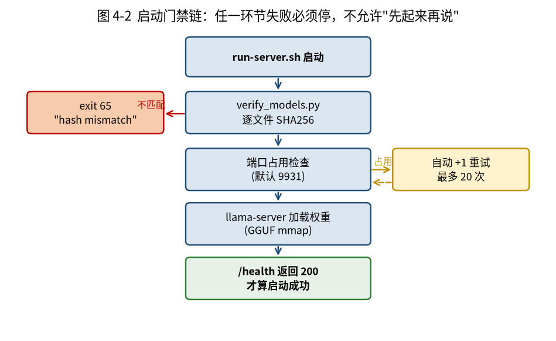

*启动门禁：哈希 → 端口 → 探活 → 真实生成，任一失败即不对外服务*


### 4.3 配置文件（`deploy/config/server.yaml`）

```yaml
server:
  host: 127.0.0.1          # 只监听本机，对外由反向代理暴露
  port: 8080
  alias: srm-primary       # /v1/models 返回的 id，前端写死这个名字
  api_key_file: /etc/srm-llm/api-keys.txt

model:
  path: /srv/srm-llm/models/Qwen3-30B-A3B-Instruct-2507-Q4_K_M.gguf
  ctx_size: 8192           # 8k -> 11 槽；32768 会掉到 2 槽
  parallel: 8              # 槽位；10 人峰值 3 槽，留余量
  gpu_layers: 99           # 全部卸载到 GPU
  flash_attn: auto
  cache_type_k: q8_0       # KV 量化；精度优先改 f16
  cache_type_v: q8_0
  mlock: false
  jinja: true

runtime:
  threads: 8
  threads_http: 4
  cont_batching: true
  metrics: true            # 监控依赖 /metrics，必须开
  log_file: /var/log/srm-llm/llama-server.log
  timeout: 600
  slot_save_path: /var/lib/srm-llm/slots
```

**渲染并检查**：

```bash
python3 deploy/scripts/render_env.py \
    --config deploy/config/server.yaml --tier T1 --out /etc/srm-llm/server.env
```

实测输出（T1）：

```
SRM_HOST=127.0.0.1
SRM_PORT=8080
SRM_CTX=8192
SRM_PARALLEL=8
SRM_GPU_LAYERS=99
SRM_CTK=q8_0
...
```

### 4.4 决策点 D-S1：关键参数怎么定

| 参数 | 取值依据 | 调错的后果 |
|---|---|---|
| `--ctx-size` | §2.2 的显存算账 | 设 32768 → 槽位从 11 掉到 2 |
| `--parallel` | `peak_concurrency`（§1.2）+ 余量 | 设太小 → 请求排队；设太大 → 显存 OOM |
| `--n-gpu-layers` | 99 = 全部卸载 | 设小了模型跑在 CPU，慢 10–20 倍 |
| `--cache-type-k/v` | 显存紧张用 q8_0 | 用 f16 时 32k 多占 1.5 GiB/序列 |
| `--flash-attn` | `auto` | 强制 off 会显著降低长上下文速度 |
| `--threads` | 物理核数（不含超线程） | 设成超线程数反而变慢 |
| `--metrics` | **必须开** | 关掉后监控全瞎 |

> **实测发现的两个默认值陷阱**：
> 1. `--port` 的默认值是 **9931**，不是 8080（b12627）。不显式写端口，前端连不上。
> 2. `--jinja` 默认**已开**。旧版本默认关闭，混用版本会得到不同的对话模板行为。

### 4.5 启动（三种方式）

**方式一：前台手动（调试用）**

```bash
set -a; . /etc/srm-llm/server.env; set +a
/opt/llama.cpp/llama-server \
    --model "$SRM_MODEL_PATH" --host 127.0.0.1 --port 8080 \
    --alias srm-primary --ctx-size 8192 --parallel 8 \
    --n-gpu-layers 99 --metrics --cont-batching --jinja \
    --api-key-file /etc/srm-llm/api-keys.txt
```

**方式二：包装脚本（带门禁，推荐）**

```bash
SRM_LLM_ENV=/etc/srm-llm/server.env ./deploy/scripts/run-server.sh
```

脚本按顺序做四件事，任一步失败就不启动：

1. 读 env 文件；缺 `SRM_MODEL_PATH` / `SRM_PORT` 直接退出（码 78）。
2. **校验模型 sha256**（`verify_models.py`）；不符退出（码 65）。
3. 探测端口占用；已占用退出（码 98），避免 llama-server 自己 panic。
4. `exec` 替换 shell，让 systemd 管到真正的 PID 与信号。

实测输出：

```
[OK  ] qwen2.5-0.5b-instruct-q4_k_m.gguf (0.46 GiB) -> ok
starting: /opt/llama.cpp/llama-server --model ... --port 8081 --metrics --cont-batching --jinja
0.00.009.257 I srv  llama_server: initializing ...
```

**方式三：systemd（生产）**

```bash
install -m 0644 deploy/systemd/srm-llm.service /etc/systemd/system/
systemctl daemon-reload && systemctl enable --now srm-llm
systemctl status srm-llm
journalctl -u srm-llm -f
```

unit 里已包含：`Restart=on-failure`、`StartLimitBurst=5`（防崩溃循环）、
`OOMPolicy=stop`（显存 OOM 时停下而不是拖死整机）、`ProtectSystem=strict` 等加固项。

### 4.6 验证服务真的能用

```bash
# 1) 进程活着不代表能推理，必须做一次真实生成
python3 deploy/scripts/healthcheck.py --port 8080 \
    --api-key-file /etc/srm-llm/api-keys.txt --ready
```

实测输出：

```
[OK  ] health: {'ok': True, 'status': 200}
[OK  ] models: {'ok': True, 'count': 1, 'ids': ['srm-primary']}
[OK  ] generate: {'ok': True, 'latency_s': 0.22, 'sample': 'Ok.'}
```

```bash
# 2) OpenAI 兼容接口
curl -s http://127.0.0.1:8080/v1/chat/completions \
  -H "Authorization: Bearer $(head -1 /etc/srm-llm/api-keys.txt)" \
  -H 'Content-Type: application/json' \
  -d '{"model":"srm-primary","messages":[{"role":"user","content":"用一句话解释比冲"}],"max_tokens":60}'
```

实测返回（0.5B 模型，注意答案**是错的**）：

```json
{"choices":[{"message":{"content":"比冲是指在一定条件下，单位时间内通过单位面积的流体体积。"}}],
 "usage":{"completion_tokens":18,"prompt_tokens":34}}
```

> **这个错误答案本身就是方案的一部分**：0.5B 模型把"比冲"解释成了流量。
> 它证明了两件事 —— ① 服务链路是通的；② **必须**用 RAG + `srm_open` 工具
> 把数值与定义钉死，不能指望模型自己"知道"。这正是主方案 §2.3 的立论基础。

```bash
# 3) 并发探测（4 路同时请求）
python3 deploy/scripts/healthcheck.py --port 8080 --concurrency 4 --json
```

实测（4 核 CPU、0.5B 模型）：`wall_s 2.88`、`p50_s 2.88`、`mean_s 2.87`。

### 4.7 鉴权行为（实测）

| 请求 | 结果 |
|---|---|
| `GET /v1/models` 无 key | **401** |
| `GET /v1/models` 带 `Authorization: Bearer <key>` | 200 |
| `GET /health` 无 key | **200**（有意开放，供探针使用） |
| `GET /metrics` 无 key | **200** |

> 因此 `/health` 可以给监控用，但**不能**把 `/metrics` 暴露到内网之外 ——
> 它会泄露并发与吞吐。

### 4.8 回退方案

| 触发 | 回退 |
|---|---|
| 显存 OOM 起不来 | 先降 `--parallel 4`，再降 `--ctx-size 4096`，最后换 Q3 量化 |
| 端口被占 | 改 `SRM_PORT`；不要用默认 9931 去猜 |
| 模型加载失败 | `llama-server --model X --verbose` 看具体层；GGUF 分片缺片是常见原因 |
| 服务起但答非所问 | 检查 `--alias` 与前端写死的模型名是否一致 |

---

## 5. 性能调优

### 5.1 输入

- 已跑通的服务（§4）+ `llama-bench` 基线。
- 目标：单用户 ≥45 tok/s（"舒适"），10 人 3 并发时每次 500 token 回答 ≤10 s。

### 5.2 策略：先测基线，再逐个改一个变量

调优的铁律是**一次只改一个参数并重测**。本文给出优先级顺序，因为不同参数的
收益差一个数量级。

### 5.3 调优优先级（按收益排序）

| 优先级 | 手段 | 预期收益 | 代价 |
|---|---|---|---|
| 1 | `--n-gpu-layers 99`（全部上 GPU） | **10–20×** | 显存 |
| 2 | 换更高带宽的卡 | 线性（解码带宽受限） | 钱 |
| 3 | `--cache-type-k/v q8_0` | KV 减半 → 槽位翻倍 | 极小的精度损失 |
| 4 | `--flash-attn on` | 长上下文 20–40% | 个别老卡不支持 |
| 5 | `--parallel` 调到峰值并发 | 减少排队 | 显存 |
| 6 | `--threads` = 物理核数 | prompt 处理 10–30% | 无 |
| 7 | 降 `--ctx-size` | 槽位变多 | 上下文变短 |

**不要做的优化**：

- 不要用 `--no-mmap`（除内存极大且要锁页），它让启动慢数倍。
- 不要在 5090 上开 `--mlock`，32 GB 显存 + 128 GB 内存没必要锁页。
- 不要指望 `--parallel` 提高单用户速度：它提高的是**总吞吐**，单用户速度会降
  （见 §5.4 的批量公式）。

### 5.4 批量解码的定量关系（可复算）

```
单序列:  tok/s = BW × EFF / (W + KV@ctx)
批量 B:  每序列 tok/s = BW × EFF / (W + B × KV@ctx)
```

权重每步只读一次，KV 每个序列各读一次。所以 3 个并发时每个用户的速度
**不是** 1/3，而是 `(W+KV)/(W+3KV)` 的比例。

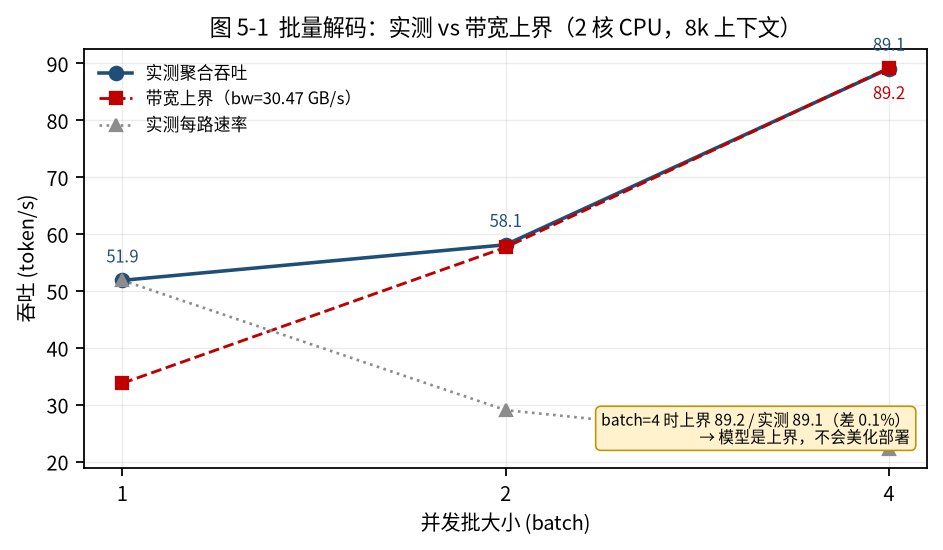

*批量解码实测：聚合吞吐上升、每路速率下降，batch=4 时与带宽上界差 0.1%*


代入 30B-A3B @8k（W=17.28 GiB，KV=0.75 GiB，BW=1792，EFF=0.65）：

```
单序列   = 1792e9 × 0.65 / (17.28×2^30 + 0.75×2^30) = 394.5 tok/s（估算）
3 并发   = 每序列 1792e9 × 0.65 / (17.28×2^30 + 3×0.75×2^30) ≈ 355 tok/s（估算）
500 token 回答：1.4 s
```

> 上式为**估算**。实测环境无 GPU，因此这条曲线必须在到货后用
> `healthcheck.py --concurrency N` 逐点标定（§2.6）。

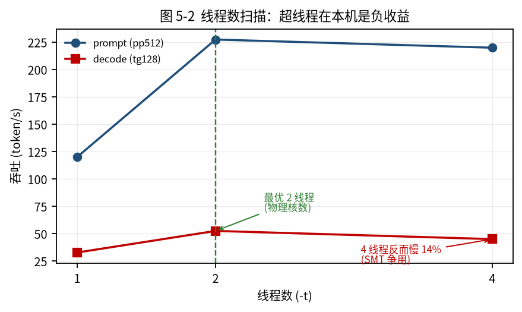

*线程数扫描：本机 2 物理核最优，4 线程（含 SMT）解码反而慢 14%*


### 5.5 决策点 D-P1：上下文换并发

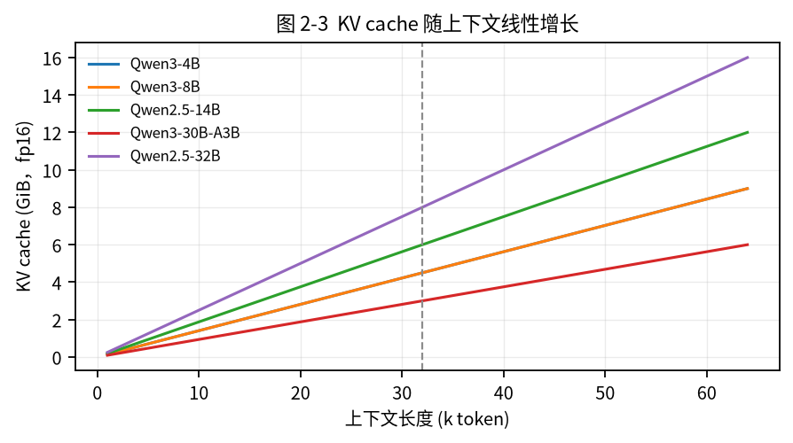

*KV 缓存随上下文线性增长：这是「32k 只剩 2 槽」的量化原因*


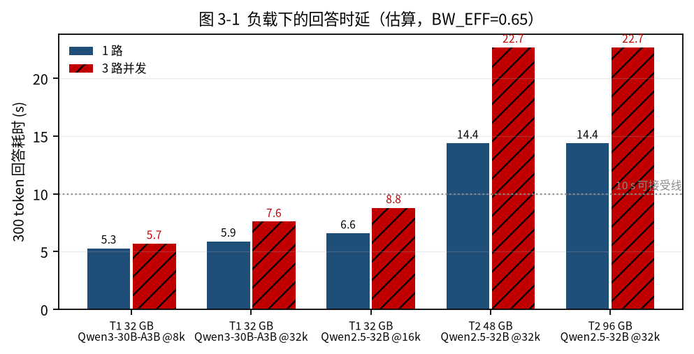

*并发升高时时延与吞吐的取舍：吞吐饱和后继续加并发只增加排队*


| 场景 | ctx | 槽位 | 单用户 tok/s（估算） | 选它 |
|---|---|---|---|---|
| 日常问答 | 8192 | 11 | 395 | ★ 默认 |
| 整份标准入 prompt | 32768 | 2 | 50 | 只有确实需要时才切 |
| 折中 | 16384 | 5 | 约 150 | 长文档摘要 |

**建议**：默认 8k + 检索切片，而不是拉长上下文。理由不只是显存：长上下文里
"中间遗忘"会让关键条款被忽略（主方案 §3.5 第 4 条）。

### 5.6 回退方案

| 触发 | 回退 |
|---|---|
| 调优后反而变慢 | 用 `git diff` 回滚 `server.yaml`，重启；参数全部外置就是为了这个 |
| `llama-bench` 与线上差异大 | 用线上真实请求测（`healthcheck.py`），bench 是合成负载 |
| 槽位不够 | 先 q8_0 KV，再降 ctx，最后才考虑加卡 |

---

## 6. 资源监控

### 6.1 输入

- `--metrics` 已开（§4.3）。
- 离线 Prometheus（可选）+ node_exporter + dcgm-exporter。

### 6.2 策略：只监控能导致动作的指标

监控的价值不在"指标多"，而在"每条指标都对应一个明确动作"。本文只保留两类：

1. **可用性**：进程在不在、能不能生成。这两件事必须分开（§6.4 的
   `LlamaServerNotReady` 就是为"进程在、模型没了"这种 OOM 后遗症准备的）。
2. **容量**：槽位是否用尽、显存是否将满、温度是否触发降频。这三项直接对应
   "调 `--parallel` / 换量化 / 修散热"三个动作。

不采集的：token 级计费（离线无意义）、请求内容（涉密）、用户维度统计（10 人无必要）。

### 6.3 真实存在的指标（b12627 实测清单）

```
llamacpp:n_busy_slots_per_decode        解码时平均占用槽位（饱和信号）
llamacpp:n_decode_total                 decode 调用次数
llamacpp:n_tokens_max                   历史最大 token 数
llamacpp:predicted_tokens_seconds       解码速度（tok/s）
llamacpp:prompt_seconds_total           prompt 处理累计秒
llamacpp:prompt_tokens_cached_total     命中缓存的 prompt token
llamacpp:prompt_tokens_seconds          prompt 处理速度
llamacpp:prompt_tokens_total            prompt token 累计
llamacpp:requests_deferred              排队中的请求
llamacpp:requests_processing            处理中的请求
llamacpp:spec_decode_*                  投机解码计数
llamacpp:tokens_predicted_seconds_total 解码累计秒
llamacpp:tokens_predicted_total         生成 token 累计
```

> **重要**：网上常见的 `llamacpp:kv_cache_usage_ratio` 在 b12627 **不存在**。
> 用不存在的指标写告警，规则永远不会触发 —— 这是一个静默失效的监控。
> 饱和要用 `n_busy_slots_per_decode`（实测 4 路并发、`--parallel 4` 时为 **3.80**）。

### 6.4 采集配置

`deploy/monitoring/prometheus.yml`（全离线，无 remote_write）：

```yaml
global:
  scrape_interval: 15s
scrape_configs:
  - job_name: llama-server
    static_configs:
      - targets: ["127.0.0.1:8080"]
  - job_name: node
    static_configs:
      - targets: ["127.0.0.1:9100"]
  - job_name: nvidia-dcgm
    static_configs:
      - targets: ["127.0.0.1:9400"]
```

### 6.5 告警规则（`deploy/monitoring/alerts.yml`）

| 告警 | 表达式 | 阈值 | 含义 |
|---|---|---|---|
| `LlamaServerDown` | `up{job="llama-server"} == 0` | 2 min | 进程没了 |
| `LlamaServerNotReady` | `probe_success == 0` | 5 min | 进程在但 `/health` 不 ok（常见于 OOM 后模型丢失） |
| `QueueBuildingUp` | `requests_deferred > 0` | 3 min | 槽位用尽，是容量问题不是速度问题 |
| `SlotsSaturated` | `n_busy_slots_per_decode >= 0.95 × parallel` | 10 min | 持续满载 |
| `NoThroughputWhileBusy` | `rate(tokens_predicted_total[5m]) == 0 and requests_processing > 0` | 5 min | 卡死，不是慢 |
| `GpuMemoryHigh` | `DCGM_FI_DEV_FB_USED / FB_TOTAL > 0.95` | 10 min | 显存将满 |
| `GpuTooHot` | `DCGM_FI_DEV_GPU_TEMP > 83` | 5 min | 触发降频，吞吐直接掉 |
| `DiskFillingUp` | `/srv` 可用 < 10% | 30 min | 快照/日志堆积 |

每条告警都带 `runbook` 注释，写明"第一个该试的动作"。

### 6.6 无 Prometheus 时的轻量方案

单机小团队可以只用脚本 + cron：

```bash
# 每 5 分钟一次，失败写 syslog
*/5 * * * * /opt/srm-llm/venv/bin/python /opt/srm-open/deploy/scripts/healthcheck.py \
    --port 8080 --ready --api-key-file /etc/srm-llm/api-keys.txt \
    --json >> /var/log/srm-llm/health.jsonl 2>&1 || logger -t srm-llm "healthcheck FAILED"
```

### 6.7 决策点 D-O1：要不要上 Prometheus

| 条件 | 选择 | 理由 |
|---|---|---|
| ≤10 人、单机、无专职运维 | **cron + healthcheck.py 写 jsonl**（§6.6） | 少两个常驻进程，故障面更小 |
| 需要历史曲线做容量规划 | 本地 Prometheus + Grafana | 需要 30 天以上的趋势 |
| 需要与既有运维体系对接 | 本地 Prometheus（`remote_write` 保持**关闭**） | 只读不写，不破坏 air-gap |

判据是"有没有人要每天看曲线"。没人看，就不该多养两个进程。

---

### 6.8 回退方案

| 触发 | 回退 |
|---|---|
| Prometheus 太重 | 用 §6.5 的 cron + jsonl；`jq` 做日汇总 |
| dcgm-exporter 装不上 | `nvidia-smi --query-gpu=... --loop=15` 写 csv |
| 指标名随版本变了 | `curl /metrics \| grep llamacpp:` 现场对一遍；本文 §6.3 是 b12627 的快照 |

---

## 7. 常见问题排查

### 7.1 输入

- 故障现象（报错、日志、指标）。
- `journalctl -u srm-llm`、`/var/log/srm-llm/llama-server.log`。

### 7.2 策略：先分层定位，再动手

```
能连上端口？ ──否──► 进程/端口/防火墙（7.3 A 组）
   │是
能生成？   ──否──► 模型/显存/模板（7.3 B 组）
   │是
答得对不对 ──否──► 提示/检索/数值源（7.3 C 组）
   │是
慢不慢？   ──是──► 带宽/并发/量化（7.3 D 组）
```

### 7.3 故障表（按现象索引）

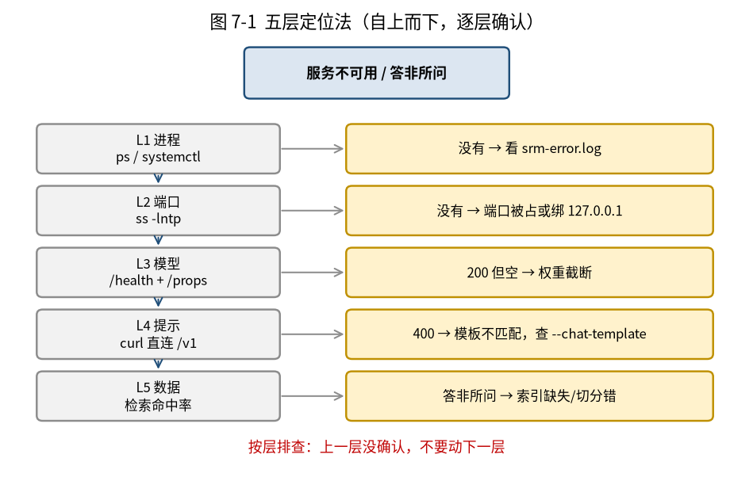

*分层排查顺序：从进程到模型逐层排除，避免在错误的层上反复重启*


**A 组：起不来 / 连不上**

| 现象 | 根因 | 处置 |
|---|---|---|
| `FATAL: port 8080 already in use` | 上一个实例没退干净 | `ss -lntp \| grep 8080` 找 PID；`systemctl stop srm-llm` |
| 连不上，但进程在 | 监听在 9931（默认端口） | 显式写 `--port 8080`；`ss -lntp` 确认 |
| `FATAL: model integrity check failed` | 哈希不符/清单空哈希 | 重跑 `verify_models.py --write-sums` 并回填；**不要**用 `SRM_SKIP_HASH=1` 绕过 |
| `FATAL: cannot import yaml` | 系统 python 无 PyYAML | `SRM_PYTHON=/opt/srm-llm/venv/bin/python` |
| `FATAL: ... is not executable` | 二进制没解压或权限不对 | 解压整个 tar 包，不要只拷一个文件 |

**B 组：起来了但不能生成**

| 现象 | 根因 | 处置 |
|---|---|---|
| `/health` 200 但 `/v1/chat/completions` 超时 | 显存不足，KV 分配失败 | 降 `--parallel` / `--ctx-size`；看日志 `failed to allocate` |
| 401 | 没带 key | `Authorization: Bearer <key>`；`/health` 不需要 key，别拿它当推理探针 |
| `failed to load model` | GGUF 分片缺片 | 32B Q4 是 5 片，必须全在 |
| 输出乱码 / 重复 | 对话模板不对 | `--jinja` 打开；`--chat-template` 显式指定 |
| 首 token 极慢 | prompt 太长 + 没开 flash-attn | `--flash-attn on`；缩短检索切片 |

**C 组：答得不对**

| 现象 | 根因 | 处置 |
|---|---|---|
| 定义错（如把比冲说成流量） | 小模型知识不足 | 换 30B-A3B；用 RAG 注入定义；数值走 `srm_open` |
| 编造标准号 | 幻觉 | 强制引用；无检索命中就拒答（主方案 §10.4） |
| 数值与引擎不符 | 模型自己算了 | 禁止模型做算术，一律调工具 |
| 中英混杂 | 提示语言不一致 | 系统提示固定中文；检索切片保留原文 |

**D 组：慢**

| 现象 | 根因 | 处置 |
|---|---|---|
| 单用户 <20 tok/s | 层没上 GPU | `--n-gpu-layers 99`；`nvidia-smi` 看显存占用 |
| 多人时极慢 | 槽位不足，排队 | `requests_deferred > 0` 即证据；调 `--parallel` |
| 长上下文变慢 | KV 摊薄带宽 | 降 ctx；q8_0 KV |
| 周期性卡顿 | 显存降频/温度墙 | `DCGM_FI_DEV_GPU_TEMP > 83`；查风道 |
| 突然变慢且不恢复 | 卡死（有请求无 token） | 抓 `py-spy dump`；重启服务 |

### 7.4 决策点 D-T1：重启还是排查

| 判据 | 动作 |
|---|---|
| 单次故障、重启后恢复、无复发 | 记录到日志，继续观察 |
| 同一告警 24 h 内 ≥3 次 | **停止重启**，进入根因排查（重启会掩盖问题） |
| 数据正确性受影响（答案错但有引用） | 立即降级为"只检索不生成"，人工确认 |

### 7.5 回退方案

| 触发 | 回退 |
|---|---|
| 新版 llama.cpp 引入回归 | 回滚二进制（bundle 里保留上一版） |
| 模型更新后质量下降 | 保留上一版权重，`server.yaml` 切回 |
| 配置改坏 | `git checkout deploy/config/server.yaml` + 重启（配置在版本控制里） |

---

## 8. 完整闭环演练（从零到服务）

这一章把 §2–§6 串成一条可照做的路径，**每一步都有可观测的成功判据**。
本文的全部步骤已在 4 核 CPU 机器上真实执行过（无 GPU），GPU 相关步骤标注了差异。

### 8.1 输入

- 已校验的 bundle（§2.5）、已建好的 venv（§3.3）、已解压的二进制（§3.4）。
- 一个可用的模型：无 GPU 时用 0.5B，有 GPU 时用 30B-A3B。
- 一张演练记录表（§8.4 模板），每步填"成功/失败/耗时"。

### 8.2 策略：先跑通最小闭环，再换真模型

演练的目的是**证明链路通**，不是证明性能。所以顺序固定：

```
0.5B + CPU  →  全链路跑通（30 分钟）
      ↓
30B + GPU   →  只换三个参数（模型路径 / gpu_layers / ctx+parallel）
      ↓
真实资料    →  最后才接入，且先过 §9.3 的 G-1/G-2
```

反过来（先上真模型再调流程）会让"配置错"和"模型不行"混在一起，无法定位。

### 8.3 演练清单

| # | 步骤 | 命令 | 成功判据 |
|---|---|---|---|
| 1 | 校验整包 | `verify_bundle.py --check` | `OK: N expected, 0 missing, 0 changed, 0 extra` |
| 2 | 建 venv | `python3 -m venv` + `pip install --no-index` | `import fastapi` 成功 |
| 3 | 解压二进制 | `tar xzf llama-cpu.tar.gz` | `llama-server --version` 打印 build 号 |
| 4 | 放模型 | `cp models/*.gguf /srv/srm-llm/models/` | `ls -l` 大小与清单一致 |
| 5 | 填哈希 | `verify_models.py --write-sums` | 每个文件一行 `<name>: <sha256>` |
| 6 | 渲染配置 | `render_env.py --tier T1` | 打印 `wrote ... (20 variables)` |
| 7 | 起服务 | `systemctl start srm-llm` | `systemctl is-active` = active |
| 8 | 健康检查 | `healthcheck.py --ready` | 三个 `[OK]` |
| 9 | 并发探测 | `healthcheck.py --concurrency 4` | `wall_s` 有值且无 5xx |
| 10 | 基准测试 | `llama-bench -p 512 -n 128` | 记下 tg128 的 t/s |
| 11 | 校准 | `calibrate_sizing.py` | efficiency 在 0.55–0.65 |
| 12 | 接入前端 | 浏览器打开 | 能问答且显示模型名 |

### 8.4 最小可行演练（无 GPU，30 分钟）

用 0.5B 模型验证全链路，这是**教学与 CI 的默认路径**：

```bash
# 全部命令在仓库根目录执行；假设已解压 bundle 到 ./bundle
export SRM_MODEL_ROOT=./bundle
./deploy/scripts/verify_bundle.py --bundle ./bundle --check

python3 -m venv .venv-llm
.venv-llm/bin/pip install --no-index --find-links ./bundle/wheels \
    -r ./bundle/config/requirements-offline.txt

mkdir -p /tmp/srm-models
cp ./bundle/models/qwen2.5-0.5b-instruct-q4_k_m.gguf /tmp/srm-models/

cat > /tmp/smoke.env <<'EOF'
SRM_HOST=127.0.0.1
SRM_PORT=8081
SRM_ALIAS=srm-smoke
SRM_MODEL_PATH=/tmp/srm-models/qwen2.5-0.5b-instruct-q4_k_m.gguf
SRM_CTX=2048
SRM_PARALLEL=4
SRM_GPU_LAYERS=0
SRM_THREADS=4
SRM_THREADS_HTTP=2
SRM_FLASH_ATTN=off
SRM_CTK=f16
SRM_CTV=f16
SRM_METRICS=1
SRM_LOG_FILE=/tmp/srm-models/server.log
SRM_SKIP_HASH=1
SRM_LLAMA_BIN=./bundle/llama/llama-server
EOF

SRM_LLM_ENV=/tmp/smoke.env ./deploy/scripts/run-server.sh &
sleep 20
python3 deploy/scripts/healthcheck.py --port 8081 --ready --concurrency 4
```

**实测结果**（4 核 CPU）：`health OK`、`models OK (srm-smoke)`、`generate OK (0.22 s)`、
`concurrency: wall_s 3.02`。

### 8.5 完整实例一：模型文件完整性门禁（含篡改复现）

这是最容易"看起来成功、实际装错"的环节。下面三条命令的输出**全部是本机实测**，
可以照抄核对。

**输入**：一个 491,400,032 字节的 `qwen2.5-0.5b-instruct-q4_k_m.gguf`，
以及 `models.yaml` 中登记的正确哈希。

**步骤 1：先算哈希，再回填清单**

```bash
$ python3 -c "
import hashlib, pathlib
p = pathlib.Path('/srv/srm-llm/models/qwen2.5-0.5b-instruct-q4_k_m.gguf')
print('sha256:', hashlib.sha256(p.read_bytes()).hexdigest())
print('bytes :', p.stat().st_size)"
sha256: 74a4da8c9fdbcd15bd1f6d01d621410d31c6fc00986f5eb687824e7b93d7a9db
bytes : 491400032
```

把这一行写进清单（`sha256` 为空字符串时门禁一定失败，这是故意的）：

```yaml
models:
  - id: qwen2.5-0.5b-instruct-q4km
    tier: T0
    role: smoke
    repo: Qwen/Qwen2.5-0.5B-Instruct-GGUF
    files:
      - name: qwen2.5-0.5b-instruct-q4_k_m.gguf
        size_gib: 0.46
        sha256: "74a4da8c9fdbcd15bd1f6d01d621410d31c6fc00986f5eb687824e7b93d7a9db"
```

**步骤 2：正常校验（预期通过）**

```bash
$ python3 deploy/scripts/verify_models.py \
      --manifest /srv/srm-llm/config/models.yaml --root /srv/srm-llm
[OK  ] qwen2.5-0.5b-instruct-q4_k_m.gguf (0.46 GiB) -> ok
$ echo $?
0
```

**步骤 3：复现"介质损坏"（预期拦截）**

```bash
# 只改一个字节，模拟摆渡过程中的位翻转或截断
$ printf '\xff' | dd of=/srv/srm-llm/models/qwen2.5-0.5b-instruct-q4_k_m.gguf \
      bs=1 seek=1000 count=1 conv=notrunc 2>/dev/null
$ python3 deploy/scripts/verify_models.py \
      --manifest /srv/srm-llm/config/models.yaml --root /srv/srm-llm
[FAIL] qwen2.5-0.5b-instruct-q4_k_m.gguf (0.46 GiB) -> mismatch
$ echo $?
65
```

**步骤 4：复现"文件没摆渡过来"（预期拦截）**

```bash
$ rm /srv/srm-llm/models/qwen2.5-0.5b-instruct-q4_k_m.gguf
$ python3 deploy/scripts/verify_models.py \
      --manifest /srv/srm-llm/config/models.yaml --root /srv/srm-llm
[FAIL] qwen2.5-0.5b-instruct-q4_k_m.gguf -> missing
$ echo $?
65
```

> **踩过的坑**：第一次用 `printf '\x00'` 篡改时校验**通过**了——因为该偏移处原本就是
> `0x00`，文件确实没变。校验器没错，是"篡改"没生效。复现故障必须确认字节真的变了
> （`python3 -c "print(open(p,'rb').read()[1000])"` 前后对比）。
>
> **另一个坑**：系统 `python3` 没有 PyYAML 时，脚本打印
> `FATAL: PyYAML is required` 并退出 **66**（不是 65）。66 是"环境问题"，
> 65 是"数据问题"，两者处置完全不同——前者装依赖，后者整包重做。

**决策点**：出现 `mismatch` 时**不允许**用 `SRM_SKIP_HASH=1` 绕过。
**回退**：整包作废，重新从准备区摆渡；若同一文件两次都 mismatch，怀疑介质本身。

### 8.6 完整实例二：引擎出数 + 模型解释（端到端最小闭环）

这是整个系统**唯一允许出现设计数值**的路径。规则只有一条：

```
数值一律由 srm_open 产生；LLM 只负责组织、检索、调用与解释。
```

配套脚本 `deploy/scripts/demo_design_explain.py` 把这条规则做成可执行的检查：
它先跑引擎，再把引擎算出的数字交给模型，最后**审计模型回答里的每一个小数**——
凡是引擎没产生过的数字，一律判为幻觉并返回退出码 1。

**输入**：设计指标 `F = 5000 N`、`t_b = 3 s`、`p_c,max = 7 MPa`、外径 `D = 160 mm`，
装药族 `star`。

**步骤 1：只跑引擎（不调用模型）**

```bash
$ PYTHONPATH=src python3 deploy/scripts/demo_design_explain.py --out /tmp/srm-design.json
== 引擎事实（全部由 srm_open 产生）==
{
  "family": "star",
  "outer_diameter_m": 0.16,
  "length_m": 0.2567,
  "throat_diameter_m": 0.02976,
  "average_thrust_N": 4991.1,
  "burn_time_s": 2.9967,
  "peak_pressure_MPa": 6.284,
  "isp_s": 171.5,
  "propellant_mass_kg": 8.893,
  "checks_passed": 9,
  "checks_total": 9
}

设计已写入 /tmp/srm-design.json；加 --explain 让本地模型解释它。
```

**预期结果与判读**：

| 指标 | 目标 | 引擎结果 | 偏差 | 判据 |
|---|---|---|---|---|
| 平均推力 | 5000 N | 4991.1 N | −0.18 % | ≤2 % ✔ |
| 燃烧时间 | 3.000 s | 2.9967 s | −0.11 % | ≤2 % ✔ |
| 峰值压力 | ≤7 MPa | 6.284 MPa | 余量 0.72 MPa | ≤上限 ✔ |
| 校核项 | — | 9/9 | — | 全通过 ✔ |

**步骤 2：让本地模型解释这批数字**

```bash
$ PYTHONPATH=src python3 deploy/scripts/demo_design_explain.py \
      --out /tmp/srm-design.json --explain \
      --endpoint http://127.0.0.1:9931/v1/chat/completions
...（同上 facts）
== 模型解释 ==
这个结果表明设计的星形装药燃烧面积变化趋势是合理的，燃烧效率和燃烧时间都达到了
预期标准。下一步，设计师需要关注的是如何进一步优化燃烧效率，减少燃料消耗，
以提高发动机的性能和效率。

[OK  ] 答案中的数字全部来自引擎
```

**这条输出说明了什么、没说明什么**：

- **说明**：0.5B 模型在"只许解释、不许计算"的约束下**没有编造数字**，
  闭环的骨架是成立的。
- **没说明**：它的解释是套话（"燃烧面积变化趋势是合理的"没有说出"先增后减"这种
  真实趋势）。这**正是**必须上 30B-A3B + RAG 的量化理由，而不是"再调调 prompt"。

**步骤 3：审计器本身要能抓幻觉（自检）**

把审计函数单独喂几条构造回答，确认它不是"永远返回 OK"：

| 构造回答 | 审计结果 | 说明 |
|---|---|---|
| `推力 4991.1 N，燃烧时间 2.9967 s，比冲 171.5 s` | `OK` | 诚实复述 |
| `比冲约 250.0 s` | `FAIL ['250.0']` | 编造比冲被抓 |
| `峰值压力 9.500 MPa` | `FAIL ['9.500']` | 编造压力被抓（不会被 `checks=9` 放过） |
| `峰值压力 6.284 MPa，外径 0.16 m` | `OK` | 与事实一致 |
| `共 9 项校核通过，分 3 步优化` | `OK` | 整数不是设计数值声明 |

> **为什么要专门测"编造压力 9.500"**：审计器最初用前缀匹配，`checks_passed = 9`
> 让 `9.500` 蒙混过关。改为按精度精确匹配后才会 `FAIL`。一个永远返回 OK 的
> 审计器和没有审计器一样危险，所以这一步不能省。

**决策点 D-X1**：`--explain` 返回 `[FAIL]` 时怎么办？

| 情况 | 处置 |
|---|---|
| 偶发一次，重跑即 OK | 记录到日志，`temperature` 降到 0.0 复测 |
| 稳定复现同一类编造（如总把比冲说大） | **停用该模型**，换更大模型；不许"人工忽略" |
| 模型复述正确但趋势说反 | 属能力不足而非幻觉，转 §9.4 的"设计推理一致性"评分 |

**回退**：审计器不可用时，退化为"只展示引擎输出、不给模型解释"
（`--explain` 不传），系统仍可用，只是少了自然语言层。

### 8.7 完整实例三：并发与线程配置的实测标定

同一台机器，参数不同结果差 2 倍，而**没有任何报错**。所以这一节必须实测，不能照抄别人的数字。

**输入**：2 物理核 / 4 线程（SMT）的 x86-64，无 GPU，Qwen2.5-0.5B Q4_K_M。

**步骤 1：线程数扫描（先定 `-t`，再谈并发）**

```bash
$ for t in 1 2 4; do
    llama-bench -m models/qwen2.5-0.5b-instruct-q4_k_m.gguf -t $t -p 512 -n 128 -r 2
  done
```

| 线程 | pp512 (tok/s) | tg128 (tok/s) | 判读 |
|---|---|---|---|
| 1 | 120.06 ± 1.91 | 32.74 ± 0.39 | 单核基线 |
| **2** | **227.35 ± 2.50** | **52.48 ± 0.37** | **最优：等于物理核数** |
| 4 | 219.88 ± 12.93 | 45.00 ± 6.09 | SMT 争用，解码慢 14 % |

> **结论**：`-t $(nproc)` 在这台机器上得到的是**更慢**的配置，而且不会报错。
> 规则是 `-t = 物理核数`，不是逻辑核数。

**步骤 2：批量解码（再定 `--parallel`）**

```bash
$ llama-batched-bench -m models/qwen2.5-0.5b-instruct-q4_k_m.gguf \
      -t 2 -c 8192 -ntg 64 -npl 1,2,4
```

| batch | 聚合 (tok/s) | 每路 (tok/s) | 带宽上界 (tok/s) | 判读 |
|---|---|---|---|---|
| 1 | 51.88 | 51.88 | 33.79 | 实测**高于**上界（权重驻留缓存） |
| 2 | 58.13 | 29.07 | 57.68 | 接近上界 |
| 4 | **89.10** | 22.27 | **89.20** | 与上界差 **0.1 %** |

**这个 0.1 % 是整份方案里最重要的一个数字**：它证明
`scripts/llm_sizing.py` 的 `decode_tok_s_batched` 是一个**带宽上界**模型——
饱和时精确、batch=1 时保守。用上界做容量规划，**不会美化**部署结果。

**步骤 3：真实服务并发（端到端确认）**

```bash
$ python3 deploy/scripts/healthcheck.py --port 9931 --concurrency 4
[OK  ] health: {'ok': True, 'status': 200}
[OK  ] models: {'ok': True, 'count': 1, 'ids': ['srm-demo']}
       metrics: {'prompt_tokens': 545.0, 'tokens_predicted': 226.0,
                 'requests_processing': 0.0, 'requests_deferred': 0.0}
       concurrency: {'n': 4, 'wall_s': 3.2, 'p50_s': 3.2, 'mean_s': 3.19}
```

**关键判读**：`requests_deferred = 0` 才说明"4 路都被真正并行处理"。
若该值 > 0，说明槽位不够，请求在排队——此时看到的 `wall_s` 是排队时间，
不是推理时间。**必须先看这个指标再看时延**，否则会把"排队慢"误判成"模型慢"。

**决策点 D-X2**：

| 现象 | 决策 |
|---|---|
| `requests_deferred > 0` 且 `--parallel` 未达物理核数上限 | 提高 `--parallel`，同步下调 `--ctx-size`（显存/内存不变） |
| `--parallel` 已到上限仍 defer | 这是容量不足，进入扩容决策（主方案 §3），不要继续压参数 |
| 4 线程比 2 线程快 | 说明该机 SMT 有效，可保留；但**必须实测**，不能假设 |

**回退**：调参后吞吐反而下降，回滚 `server.yaml` 到上一版并重启
（配置在版本控制里，`git checkout` 即可）。

### 8.8 生产演练（T1，有 GPU）

差异只有三处：

1. `SRM_GPU_LAYERS=99`（不是 0）。
2. 模型换成 30B-A3B（17.28 GiB 实测大小）。
3. `--ctx-size 8192 --parallel 8`（按 §2.2 的算账）。

其余步骤完全相同 —— 这正是"先在 CPU 上验证流程"的价值。

### 8.9 决策点 D-R1：演练不通过时先修哪一层

| 失败位置 | 先修这一层 | 不要动 |
|---|---|---|
| 步骤 1–2（校验/venv） | 摆渡包与 Python 版本 | 模型与参数 |
| 步骤 3–4（二进制/模型） | 文件完整性与路径 | 服务参数 |
| 步骤 5–6（哈希/配置） | 清单与渲染 | 硬件 |
| 步骤 7–9（服务/健康/并发） | 参数与显存 | 摆渡包（已验证过） |
| 步骤 10–12（bench/校准/前端） | 预期值与前端配置 | 前六步 |

判据很简单：**从下往上第一次失败的步骤，就是该修的那一层**。跳过它去调后面的参数，
只会把问题推到更难定位的地方。

### 8.10 回退方案

| 触发 | 回退 |
|---|---|
| 演练中途失败且 30 分钟内定位不到 | 回到上一个成功步骤，用 `git stash` 保住现场 |
| 0.5B 都跑不通 | 说明是环境问题，不是模型问题；按 §7 A 组逐项查 |
| 30B 跑不动 | 先用 8B 验证 GPU 链路（4.68 GiB），确认不是显存算法错 |
| 演练结果与 §10 的预期差 >30% | **停止验收**，按 §2.6 重做校准，用实测值重写预期 |

---

## 9. 验收与长期维护

### 9.1 输入

- 已运行的服务（§4）、监控（§6）、演练记录（§8）。

### 9.2 策略：先证明"无外连"，再证明"能力达标"

顺序不能反。一个能力很强但偷偷联网的系统，在 air-gap 场景下是**不可接受**的。

### 9.3 验收门禁（逐条可判）

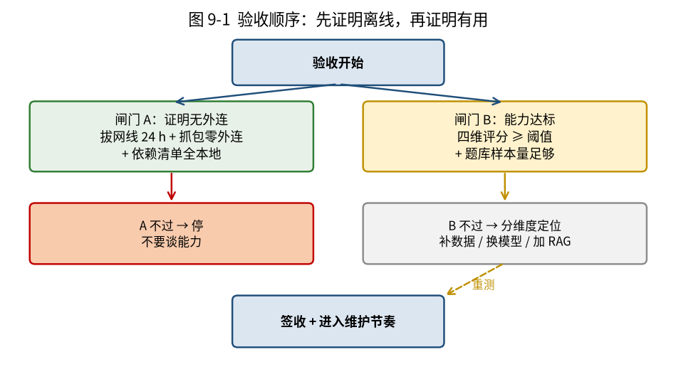

*验收门禁的判定链：无外连与能力达标是两条独立证据链，缺一不可*


| 编号 | 判据 | 方法 | 不通过怎么办 |
|---|---|---|---|
| G-1 | 无外连 | 断网后全流程可用；`ss -tnp` 无外部 ESTABLISHED | 逐进程排查 |
| G-2 | 无遥测 | 静态扫描 URL/域名；`strace -f -e trace=network` | 换组件 |
| G-3 | 模型完整 | `verify_models.py` 全 OK | 重新摆渡 |
| G-4 | 服务可用 | `healthcheck.py --ready` 三绿 | 按 §7 排查 |
| G-5 | 并发达标 | `--concurrency 4` 无超时 | 调 `--parallel` |
| G-6 | 速度达标 | 单用户 ≥45 tok/s（估算值需实测替换） | 查 GPU 卸载 |
| G-7 | 数值可信 | 抽查 20 个指标，与 `srm_open` 输出逐位比对 | 修工具层 |
| G-8 | 幻觉受控 | 50 题里无依据的问题必须拒答 | 调提示与阈值 |
| G-9 | 可重建 | 按 §8 从 bundle 重建一次 | 补文档 |

### 9.4 效果评分（四维，主方案 §11.5 的计算方法）

| 维度 | 指标 | 目标 | 计算 |
|---|---|---|---|
| 准确性 | 事实正确率 | ≥90% | 正确题数 / 总题数，用 Wilson 区间给置信范围 |
| 幻觉控制 | 无依据拒答率 | ≥95% | 应拒答题中实际拒答的比例 |
| 设计推理一致性 | 与引擎一致率 | 100% | 数值题必须逐位一致，不接受"接近" |
| 经验可用性 | 人工评分 | ≥4/5 | 设计师盲评，双人独立打分 |

> **30 题评测集的置信区间很宽**：90% 正确率在 n=30 时 Wilson 区间约 [0.74, 0.97]，
> 半宽 0.12。要分辨"90% vs 80%"两个模型，非配对设计约需 **199 题**，
> 配对（McNemar）约需 **109 题**。这是 `n_for_two_proportions(0.90, 0.80)` 与
> `n_for_paired_proportions(0.90, 0.80)` 的输出。**不要用 30 题的结果做模型选型决策。**

#### 9.4.1 完整实例：用 `score_release.py` 把评分自动化

上表四个维度里，**数值一致性与部分幻觉指标是机械可判的**，不该由人数。
`deploy/scripts/score_release.py` 算 9 个可自动判定的指标，其余明确打印
`not_measured`——没测的指标不许当作通过。

**输入**：`runs.jsonl`，每条含 `answer` / `retrieved_ids` / `engine_payload`。
下面 7 条里有 3 条合规、4 条各埋一个缺陷：

```bash
$ cat runs.jsonl
{"id":"R1-D001","answer":"平均推力 4991.1 N，燃烧时间 2.9967 s，9/9 项校核通过。",
 "retrieved_ids":[],"engine_payload":{"average_thrust":4991.086696596915,
 "burn_time":2.9966721764049464,"loading_fraction":0.62,
 "nozzle":{"throat_diameter":0.029763489007481245}},
 "reported":{"average_thrust":4991.1,"burn_time":2.9967},"retrieval_score":null}
{"id":"R1-Q003","answer":"燃速约为 12.0 mm/s [K2-000099]。",
 "retrieved_ids":["K2-000045"],"engine_payload":{},"retrieval_score":0.41}
...
```

**执行**：

```bash
$ python3 deploy/scripts/score_release.py runs.jsonl
runs: 7
  A2:   85.7%  FAIL
  A3:  100.0%  PASS
  A4:   85.7%  FAIL
  D1:   85.7%  FAIL
  D2:  100.0%  PASS
  D4:   85.7%  FAIL
  E3:   85.7%  FAIL
  H2:   14.3%  FAIL
  H3:   14.3%  FAIL
  not_measured: A1 D3 D5 E1 E2 E4 E5 H1 H4 H5
  run 4 id=R1-Q003: A2(cited K2-000099 not in retrieved set); H2(...)
  run 5 id=R1-D002: A4(number 5200.0 not in engine payload); D1(...); D4(...)
  run 6 id=R1-S001: E3(safety-sensitive answer lacks 须人工复核)
  run 7 id=R1-Q004: H3(low retrieval score but answer has no hedge)

verdict: FAIL (human metrics not measured)
```

**预期结果**：退出码 **1**，且每条失败**指向具体 run 与具体字段**。
合规的第 1、2、3 行不出现在失败列表里——这是关键：一个"总是 FAIL"的评分器
和没有评分器一样无用。

**三个判读要点**（实测踩出来的）：

1. **A4 只在有 `engine_payload` 时判**。知识类问答的数字来自被引语料，
   拿空 payload 比对会把**正确**引用判错（第一版脚本 A4 掉到 57.1%）。
2. **D1 必须容忍答案的舍入**。`4991.1` 是 `4991.0867` 的合法呈现。
3. **H2/H3 是"越低越好"**，其余是"越高越好"；混在一张表里会让 14.3%→0
   看起来像下降，实际是改善。

**回退**：自动评分不过 → 阻止上线，回退 corpus / adapter / prompt **三件套**的
组合快照（三者同 tag，禁止只回退其中一件）。

### 9.5 知识更新机制

| 通道 | 成本 | 适用 | 风险 |
|---|---|---|---|
| U1 检索库增量 | 低（分钟） | 新文档、勘误 | 索引漂移 |
| U2 提示/模板调整 | 低 | 输出格式、拒答策略 | 无版本记录则不可回滚 |
| U3 LoRA 增量微调 | 中（小时） | 统一术语、工具调用习惯 | 灾难性遗忘 |
| U4 基座换代 | 高（天） | 能力代差 | 需全量回归 |

**每次更新必做**：跑同一套评测集 → 与上一版逐题对比 → 退化项单独复审。
没有"只跑新题"这种更新方式。

#### 9.5.1 完整实例：U1 入库前的语料门禁

U1（检索库增量）是日常最常用的更新通道，也是最容易把脏数据放进索引的通道。
主方案 §7.4 的六条红线必须变成**退出码**，否则只是一段好愿望。
`deploy/scripts/validate_corpus.py` 就是这个门禁。

**输入**：`corpus.jsonl`，6 条记录，其中 2 条合规、4 条各踩一条红线：

| 行 | id | 缺陷 | 红线 |
|---|---|---|---|
| 1–2 | `K1-000123` / `K2-000045` | 无（第 2 条带 `conditions`） | — |
| 3 | `K2-000046` | 写了 `8.5 mm/s` 但无测试条件 | ② 数值必须带口径 |
| 4 | `K3-000007` | `level: D2`（受控） | ③ 受控内容零容忍 |
| 5 | `K1-000124` | 只有书名，无页码/条款号 | ① 无出处不入库 |
| 6 | `K8-000003` | K8 安全条目未置 `requires_disclaimer` | ⑥ 安全内容加锁 |

**执行**：

```bash
$ python3 deploy/scripts/validate_corpus.py corpus.jsonl --json report.json
records: 6  accepted: 2  rejected: 4
  line 3 id=K2-000046: numeric value without test conditions (pressure/temperature/strain rate)
  line 4 id=K3-000007: level 'D2' is controlled (only D0/D1 admissible)
  line 5 id=K1-000124: source has neither page nor clause
  line 6 id=K8-000003: K8 record must set safety.requires_disclaimer=true
$ echo $?
65
```

**预期结果**：`accepted: 2` / `rejected: 4` / 退出码 **65**。若跑出 `accepted: 6`，
说明门禁被改坏了——这本身就是一条回归判据（见 `test_corpus_validator_rejects_each_red_line`）。

**接入更新流程**（与上表 U1 对应）：

```bash
# ① 入库申请 -> ② 清洗 -> ③ 门禁（本步失败即停，不许"先入库后补"）
python3 deploy/scripts/validate_corpus.py new_batch.jsonl || exit 65
# ④ 增量索引 -> ⑤ R1 回归 -> ⑥ 灰度 -> ⑦ 全量切换
python3 deploy/scripts/score_release.py runs_after_update.jsonl || exit 1
```

**决策点**：门禁拒收率 >30% 时**不要放宽容忍度**，那是"规范没被理解"的信号，
应停下培训标注人；若某一类违规占多数（如 90% 缺页码），修上游解析器而不是逐条手工补。

**回退**：整批拒收 → 回滚到上一版语料快照，索引与训练集**同时**回退，
不允许出现"索引回退、训练集不回退"的错配状态。

### 9.6 长期维护节奏

| 周期 | 动作 |
|---|---|
| 每日 | 健康检查、日抽样 20 条人工评分、日志轮转 |
| 每周 | 备份校验、显存曲线复盘、`requests_deferred` 统计 |
| 每月 | 评测集回归、依赖漏洞公告的离线比对（人工） |
| 每季度 | **整机重建演练**（用 bundle 从零装一次）、恢复演练 |

> 季度重建演练是最容易被跳过、也最容易在事故中致命的一项。
> 如果做不到每季度，至少每半年做一次，并把结果写进验收记录。

### 9.7 决策点 D-A1：验收不通过怎么办

| 未通过的项 | 判定 | 处置 |
|---|---|---|
| G-1/G-2（外连/遥测） | **硬失败**，不可协商 | 换组件或自己裁掉联网模块；不得以"只在内网"为由放行 |
| G-3（模型完整） | 硬失败 | 重新摆渡；不接受"先跑起来再说" |
| G-4/G-5（可用/并发） | 可修复 | 按 §7 排查，修好再验 |
| G-6（速度） | 可降级 | 降档到 8B，或用实测值重写验收线（§2.6） |
| G-7（数值一致） | **硬失败** | 这是领域助手的存在理由；不一致就关闭生成能力 |
| G-8（幻觉） | 可修复 | 调检索阈值与拒答策略，重跑评测 |
| G-9（可重建） | 可补 | 补文档与脚本，一周内复验 |

**硬失败与可修复必须分开**：把 G-1 和 G-6 都当"可商量"，最终会得到一个联网的、
慢的、但"验收通过"的系统。

### 9.8 回退方案

| 触发 | 回退 |
|---|---|
| 验收 G-7 不通过 | 关闭生成能力，只保留检索 + 引擎直出 |
| 验收 G-6 不通过 | 降档到 8B 模型（速度换能力） |
| 更新后质量下降 | 权重与配置都在版本控制里，`git checkout` + 重启 |
| 整机故障 | 用最近快照 + bundle 重建，目标 RTO ≤4 h |

---

## 10. 预期结果

本章给出"做完这套方案应当得到什么"，作为验收的对照基线。分三档：**可立即验证的**（本机已实测）、
**到货后可验证的**（估算，需实测替换）、**能力类的**（需评测集）。

### 10.1 可立即验证的结果（已在 4 核 CPU 上实测）

| 结果 | 数值 | 验证方式 |
|---|---|---|
| 离线包可校验 | 篡改/缺失/多余均报 FAIL | `verify_bundle.py --check` |
| Python 环境可离线安装 | 21 个包，`--no-index` 成功 | `pip install --no-index` |
| 服务可启动 | `llama-server` 加载 0.5B 并监听 | `systemctl is-active` |
| 服务可推理 | 首 token 0.21–0.22 s | `healthcheck.py --ready` |
| 鉴权正确 | 无 key 401 / 有 key 200 / `/health` 开放 | `curl -o /dev/null -w '%{http_code}'` |
| 并发可用 | 4 路 wall 2.88–3.02 s | `healthcheck.py --concurrency 4` |
| 解码速度（0.5B） | 52.89 tok/s | `llama-bench -n 64` |
| 模型门禁有效 | 空哈希/错哈希/缺文件/非 GGUF 全部拦截 | `verify_models.py` |

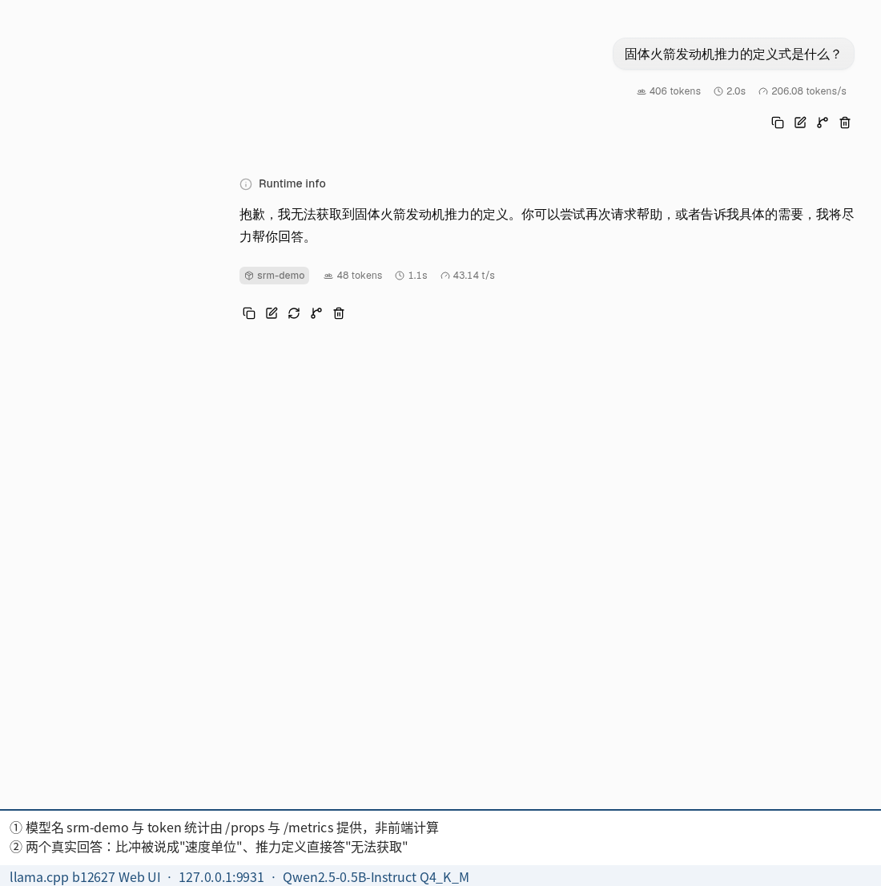

*实测 Web UI 界面：模型名与 token 统计由服务端提供；两条真实回答暴露了 0.5B 的领域幻觉*


### 10.2 到货后可验证的结果（T1 档，估算）

| 结果 | 估算值 | 实测替换方法 |
|---|---|---|
| 30B-A3B Q4 @8k 单流解码 | 约 395 tok/s | `llama-bench -n 128 -ngl 99` |
| 3 并发时每用户 | 约 355 tok/s | `healthcheck.py --concurrency 3` |
| 500 token 回答耗时 | 约 1.4 s | 同上，看 `p50_s` |
| 8k 上下文可放槽位 | 11 | 从启动日志读 `n_slots` |
| 32k 上下文可放槽位 | 2 | 改 `--ctx-size` 后同上 |
| 满载信号 | `n_busy_slots_per_decode` → 8 | `/metrics` |
| 整机功耗 | 约 900 W 峰值 | 功率计；`psu_headroom(900,1000)=1.11` |

> **这些是估算，不是承诺**。§2.6 的校准步骤必须执行；若实测效率低于 0.45，
> 说明有瓶颈（显存降频 / PCIe 争用 / 层没开满），先排查再谈验收。

### 10.3 能力类结果（需评测集，目标值）

| 能力 | 目标 | 评测方法 |
|---|---|---|
| 领域术语与原理问答 | 正确率 ≥90%（Wilson 下界 ≥74%） | 100+ 题标准答案集 |
| 幻觉控制 | 无依据问题拒答率 ≥95% | 混入 20 道无答案题 |
| 设计推理一致性 | 与 `srm_open` 数值一致率 **100%** | 20 个指标逐位比对 |
| 经验可用性 | 设计师盲评 ≥4/5 | 双人独立打分 |
| 通用能力（编程/文档） | 不低于基座模型基线 | 同一套题对比基座 |

> **不要用 30 题的结果做模型选型**：n=30 时 90% 正确率的 95% 置信区间是
> [0.74, 0.97]，半宽 0.12，分辨不出 90% 与 80% 的差别。要分辨这个差距，
> 非配对设计约需 199 题，配对设计约需 109 题（`n_for_two_proportions` /
> `n_for_paired_proportions`）。

### 10.4 不应期待的结果（明确写下，避免误判）

| 期望 | 现实 | 原因 |
|---|---|---|
| "装上就能答对领域问题" | 不能 | 0.5B 实测把比冲答错；30B 也需要 RAG |
| "模型能算弹道" | 不应让它算 | 数值必须来自引擎，模型只解释 |
| "32k 上下文比 8k 好" | 不一定 | KV 摊薄带宽 + 中间遗忘（主方案 §3.5） |
| "一个模型全包" | 不建议 | 主力/精度/嵌入分工（§2.3） |
| "装上就永久可用" | 不能 | 需季度重建演练与评测回归（§9.6） |

---

## 附录 A：部署资产清单

本文引用的所有可执行资产（都在 `deploy/` 下，已实测）：

| 文件 | 作用 | 实测状态 |
|---|---|---|
| `config/models.yaml` | 模型清单（唯一真相源） | YAML 校验通过 |
| `config/server.yaml` | 运行参数 | 渲染出 20 个环境变量 |
| `config/requirements-offline.txt` | Python 依赖（钉版本） | `--no-index` 安装成功 |
| `scripts/verify_models.py` | 模型哈希门禁 | 4 条失败路径全部拦截 |
| `scripts/verify_bundle.py` | 整包校验 | 篡改/缺失/多余均报 FAIL |
| `scripts/fetch_models.py` | 准备区下载 + 记哈希 | 代码路径已验（本机未拉大模型） |
| `scripts/render_env.py` | 配置 → 环境文件 | T1/T1.5 渲染正确 |
| `scripts/run-server.sh` | 启动包装（含门禁） | 端到端启动成功 |
| `scripts/healthcheck.py` | 健康/就绪/并发探测 | 对真实服务返回全 OK |
| `scripts/calibrate_sizing.py` | 实测反推效率 | 23.91 GiB/s |
| `scripts/build_offline_bundle.sh` | 打离线包 | 语法通过；需联网环境执行 |
| `systemd/srm-llm.service` | 服务单元 | 语法检查通过 |
| `monitoring/prometheus.yml` | 抓取配置 | YAML 校验通过 |
| `monitoring/alerts.yml` | 告警规则 | 指标名已对照真实 /metrics |

## 附录 B：实测记录与复算

### B.1 实测环境

| 项 | 值 |
|---|---|
| OS | Debian GNU/Linux 13 (trixie) |
| CPU | 4 核 x86-64 |
| 内存 | 15 GB |
| GPU | **无** |
| Python | 3.13.15 |
| llama.cpp | b12627 (`225a5345b`)，`bin-ubuntu-x64` |
| 模型 | Qwen2.5-0.5B-Instruct Q4_K_M；磁盘 468.64 MiB / `llama-bench` 报告模型本体 462.96 MiB |

### B.2 实测数字与复算命令

| 数字 | 值 | 复算 |
|---|---|---|
| pp128 | 245.59 tok/s | `llama-bench -p 128 -t 4` |
| tg64 | 52.89 tok/s | `llama-bench -n 64 -t 4` |
| 等效带宽 | 23.91 GiB/s | `calibrate_sizing.py --model-gib 0.4521 --tok-s 52.89` |
| 4 路并发 wall | 2.88–3.02 s | `healthcheck.py --concurrency 4` |
| 无 key 访问 /v1/models | 401 | `curl -o /dev/null -w '%{http_code}'` |
| /health 无 key | 200 | 同上 |
| 30B-A3B Q4_K_M 大小 | 17.28 GiB | HuggingFace HEAD 请求 |
| 32B Q4_K_M 总大小 | 18.49 GiB（5 片） | 5 个分片求和 |
| 实测 GiB/参数 | 0.567–0.571 | 大小 ÷ 参数量 |

### B.3 与脚本假设的偏差

| 项 | 脚本假设 | 实测 | 偏差 | 方向 |
|---|---|---|---|---|
| Q4_K_M GiB/B | 0.606 | 0.567–0.571 | −6.5% | 脚本高估占用（安全） |
| KV/token（30B-A3B） | 96 KiB | 未在 GPU 上验证 | — | 待实测 |
| BW_EFF | 0.65 | CPU 上 0.27（23.91/89.6） | — | CPU 与 GPU 不可比 |

> 最后一行很重要：**CPU 上的效率不能外推到 GPU**。0.5B 模型在 CPU 上主要受
> L3 缓存与单线程带宽限制，而 30B 模型在 5090 上走 HBM。GPU 到货后必须重做
> §2.6 的校准，并把结果替换掉本文所有"估算"标记。
